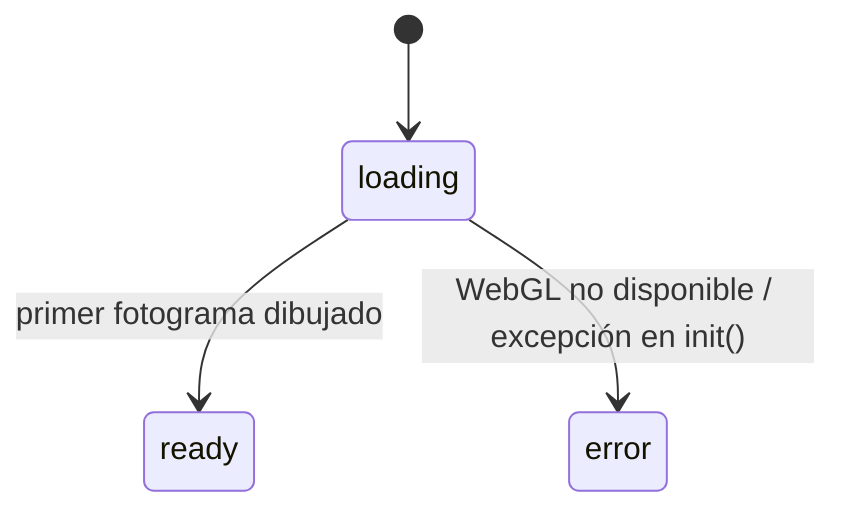
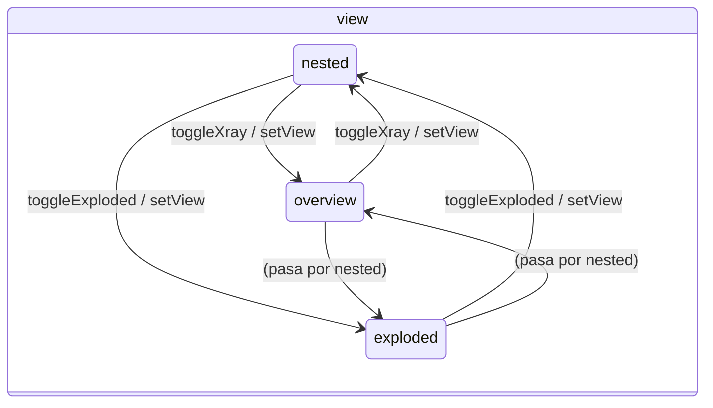
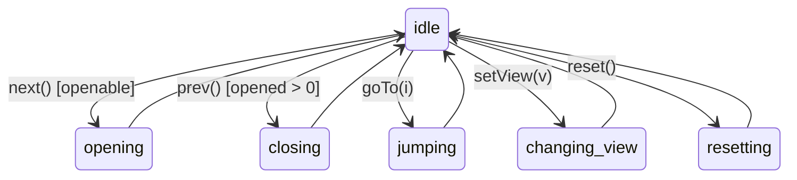
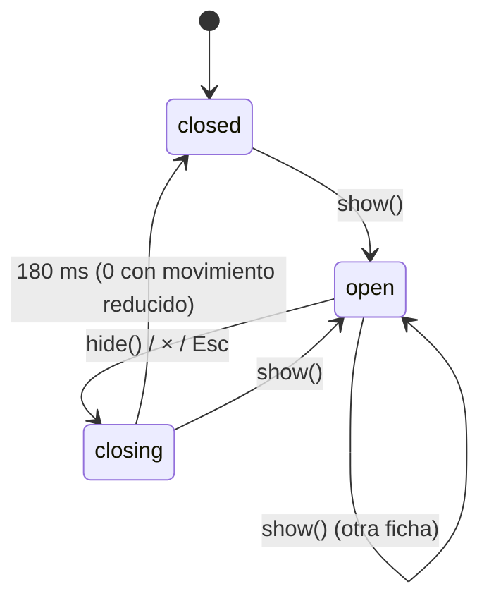
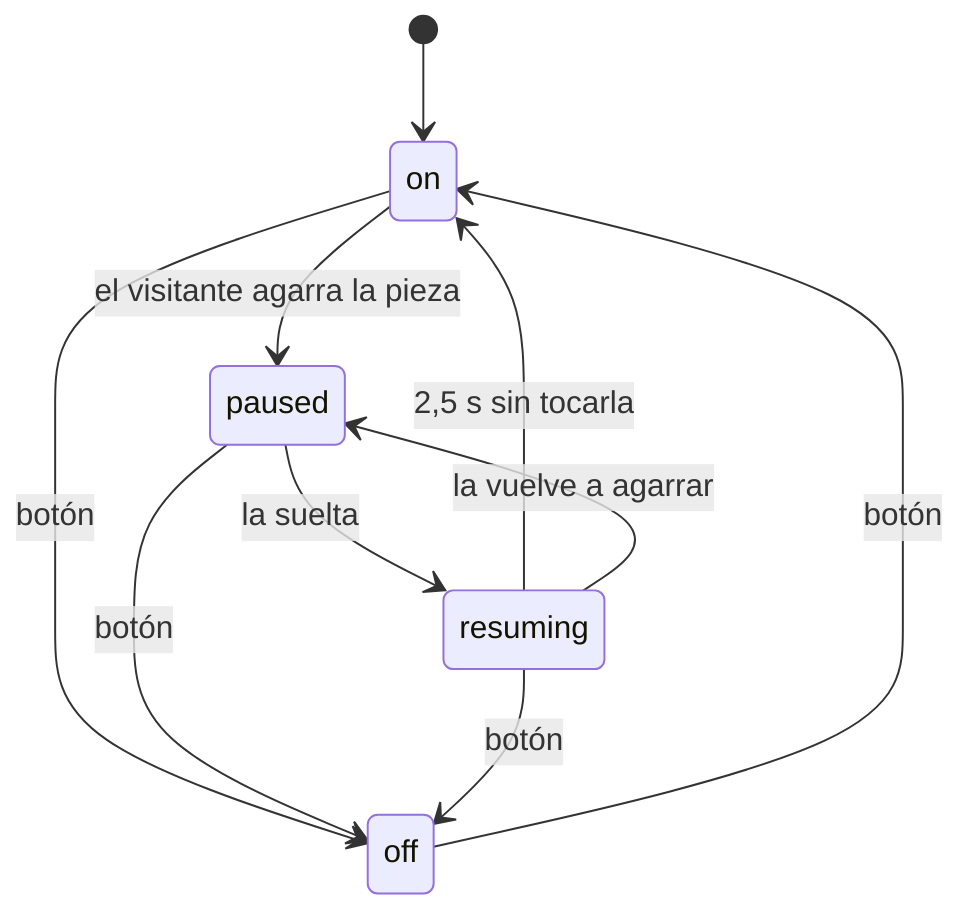
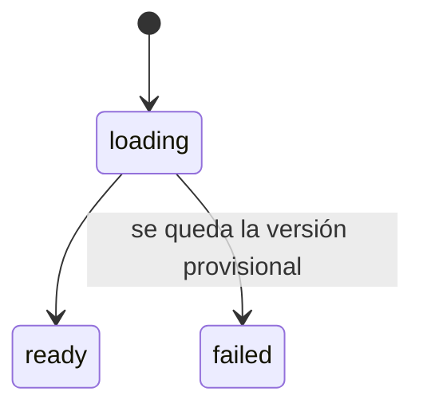

# Máquinas de estado

Toda la interacción de la cámara funeraria se reduce a unas pocas máquinas de estado. Antes estaban
repartidas en booleanos (`xray`, `exploded`, `busy`, `_wasAuto`, `root.hidden` + clase `closing`…);
ahora cada una tiene sus estados con nombre, sus transiciones en un solo sitio y una foto
serializable. Este documento es el inventario: qué máquina hay, dónde vive y cómo cambia.

Foto completa en cualquier momento: `window.__tut.state()` (ver [AGENTS.md](../AGENTS.md)).
Las más importantes se reflejan también como atributos de `#app`:

```html
<div id="app" data-boot="ready" data-mode="free" data-opened="4" data-view="nested"
     data-activity="idle" data-panel="open" data-autorotate="on" data-quality="alta">
```

| # | Máquina | Estados | Dónde |
|---|---|---|---|
| 1 | Arranque | `loading` · `ready` · `error` | `BOOT` en `js/main.js` |
| 2 | Modo de la app | `discovery` · `free` · `gallery` | `MODES` en `js/main.js` |
| 3 | Etapa (capas abiertas) | `opened` = 0…8 | `LayerSystem` |
| 4 | Vista del conjunto | `nested` · `overview` · `exploded` | `VIEW` en `js/layers/layerSystem.js` |
| 5 | Orden en curso | `idle` · `opening` · `closing` · `jumping` · `changing-view` · `resetting` | `ACTIVITY` en `js/layers/layerSystem.js` |
| 6 | Ficha | `closed` · `open` · `closing` | `PANEL` en `js/ui/infoPanel.js` |
| 7 | Giro automático (galería) | `off` · `on` · `paused` · `resuming` | `AUTO` en `js/gallery/autoRotate.js` |
| 8 | Vuelo de cámara | libre · en vuelo (un canal por cámara) | `flyTo` / `stopFlight` en `js/core/scene.js`, canales en `js/core/tween.js` |
| 9 | Calidad | `alta` · `normal` | `QUALITY` en `js/core/postfx.js` |
| 10 | Descargas (máscara, HDRI) | `loading` · `ready` · `failed` | `ASSET`, `assetStatus` en `js/core/assets.js` |

No son máquinas de estado, sino **canales de animación continuos** (0…1) que las máquinas 3 y 4
interpolan: `open`, `ghostOpen`, `ghostScale`, `xray` y `explode` de cada `Structure`
(`js/models/structure.js`). Su combinación decide la opacidad (`applyVisual`).

---

## 1. Arranque



`ready` quita la pantalla «Preparando la cámara…». `error` la quita y muestra el mensaje.

## 2. Modo de la app

Cualquier modo pasa a cualquier otro con `setMode(modo)`. La tabla `MODES` declara qué cambia:

| | `discovery` | `free` | `gallery` |
|---|---|---|---|
| Escena | cámara funeraria | cámara funeraria | galería |
| Guía compacta | no | sí | (oculta) |
| Saltar desde la lista de capas / «Ir a esta capa» | no | sí | — |
| Teclas ← → | sí | sí | no |

Al cambiar de modo siempre se cierra la ficha y se borra la selección. Al entrar en la galería se
muestra la última pieza vista (o la primera).

## 3–5. Capas: etapa, vista y orden en curso

Tres variables ortogonales en `LayerSystem`:

- `opened` (0…8): capas abiertas. La «actual» es `structures[min(opened, 8)]`.
- `view`: cómo se ve el conjunto.
- `activity`: la orden que se está animando. Solo una a la vez.





Reglas:

- **Una orden cada vez.** Si `activity ≠ idle`, cualquier orden nueva no hace nada y su Promise se
  resuelve con `false`. La interfaz desactiva los botones mientras tanto.
- **Valor final al empezar.** `opened` y `view` cambian al principio de la transición (el botón
  «Vista general» ya aparece pulsado mientras se anima); `activity` indica que aún se mueve.
- **Abrir, cerrar, saltar y restablecer vuelven antes a `nested`** (sin reencuadrar) y después
  animan las capas.
- `goTo(i)` abre o cierra en orden, acelerado (×1,4 si es un paso, ×2,6 si son varios); `reset()`
  cierra todo a ×3.
- Avisos a `onChange(type)`: `activity` (empieza una orden), `opened` (una capa terminó de abrirse),
  `closing` (una capa empieza a cerrarse), `idle` (terminó la orden).

## 6. Ficha



`onClose` se avisa al pasar a `closing` (ahí se quita el resaltado de la pieza). `isOpen` es
`state === 'open'`.

## 7. Giro automático de la galería



El botón muestra la preferencia (`enabled`: todo menos `off`); la pieza gira solo en `on`.
Arrastrar en `off` no hace nada.

*Corrige dos fallos del código anterior:* dos arrastres seguidos en menos de 2,5 s apagaban el giro
para siempre aunque el botón siguiera «activado», y apagar el giro justo después de soltar la pieza
podía volver a encenderlo a los 2,5 s.

## 8. Vuelo de cámara

`flyTo(camera, …)` anima la cámara en arco. Cada cámara tiene **un canal**: un vuelo nuevo
sustituye al que esté en curso (se detiene donde está, sin saltos), y cuando el visitante empieza a
arrastrar, hacer zoom o desplazar, `stopFlight(camera)` lo detiene. La Promise de un vuelo se
resuelve con `true` si llegó al final y `false` si se interrumpió; las órdenes de capas siguen
igualmente (la animación de las capas no depende de la cámara).

*Antes:* dos vuelos podían mover la misma cámara a la vez (clics rápidos en la galería) y la cámara
«peleaba» con el ratón del visitante hasta terminar el vuelo.

El canal es genérico: cualquier `tween({ channel })` sustituye al anterior del mismo canal, y
`cancelChannel(channel)` lo detiene.

## 9. Calidad

`alta` (oclusión ambiental GTAO, se crea al usarse por primera vez) o `normal`. Valor inicial:
`?lite` → `?calidad=` → lo guardado en `localStorage` → según el equipo. `setQuality(q)` lo cambia y
lo guarda. Los valores siguen en español porque son los que ya están guardados en los navegadores y
los que acepta la URL.

## 10. Descargas



`mask` (modelo glTF de la máscara; mientras, la procedural) y `hdri` (entorno de sala; mientras,
`RoomEnvironment`). Nunca bloquean la escena. Cada cambio emite `tut:asset` en `window`.
